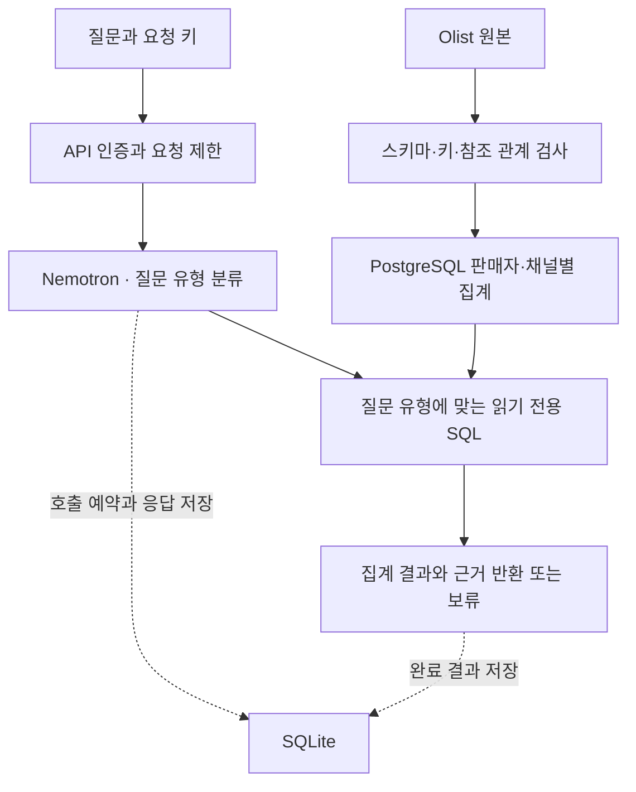

# Agentic Marketing Data Pipeline

계약한 판매자의 주문은 실제로 몇 건이나 잡힐까? Olist가 공개한 판매자·주문 자료로 이 질문을 살펴본 개인 프로젝트입니다. 두 자료를 PostgreSQL에 적재하고, 한국어로 질문하면 SQL로 집계한 숫자와 근거를 함께 보여주는 API를 만들었습니다.

<a id="맡은-범위"></a>

두 표본을 판매자 ID로 연결해 보니 계약 842건 중 380건만 커머스 표본의 판매자 명단에서 찾을 수 있었습니다. 나머지 **462건은 주문이 몇 건인지 이 자료로 알 수 없어** 주문 수를 `NULL`로 남겼습니다. 명단에 있는 판매자의 주문이 표본에서 한 건도 잡히지 않을 때만 0건으로 셉니다. API가 돌려준 미연결 계약 수를 SQL로 다시 조회해도 462건이 나왔습니다. [집계 SQL](src/llm_ops_lab/olist/transform.sql) · [DB 집계 결과](evidence/olist-semantics-20261018/independent-core-counts.json) · [API 응답 기록](evidence/olist-durable-aws-20261012/aws-http.json)

모델에 요청을 보내고 응답을 저장하기 전에 워커가 멈추면 같은 요청에 비용이 두 번 들 수 있습니다. 그래서 모델을 부르기 전에 호출 1회를 예약하고, 받은 응답도 따로 저장하게 했습니다. 2026년 10월 12일 AWS 시험에서 새 요청을 넣자 누적 예약이 3회에서 4회가 됐습니다. 그때 워커를 끄고 새 워커에 같은 키로 다시 요청해도 **예약은 4회 그대로**였습니다. API는 앞선 호출의 결과를 확인할 수 없다는 오류를 돌려줬습니다. AWS 배포와 시험은 제가 승인한 범위에서 AI 도구가 실행했습니다. [워커 종료 전후 기록](evidence/olist-durable-aws-20261012/worker-fault.json)

[포트폴리오](https://jungseongheon.org/portfolio/#agentic-marketing) · [AWS 복원 기록](#백업에서-되살려-본-것) · [실행과 재현](#실행과-재현)

<a id="마케팅커머스에서-해결하려는-문제"></a>

## 채널과 판매자별로 숫자를 셀 때

| 조회할 값 | 집계할 때 정한 기준 |
|---|---|
| 유입 경로별 리드 수 | 전체 리드 8,000건 중 60건은 유입 경로(`origin`)가 비어 있었습니다. 이 60건도 전체 분모에 넣고, 채널별 표에서 따로 볼 수 있게 했습니다. |
| 판매자별 주문 수 | 한 주문에 상품이 여럿 있어도 해당 판매자에게는 한 건이므로 `COUNT(DISTINCT order_id)`로 셉니다. 여러 판매자가 참여한 주문은 각각에게 잡히므로 이 숫자를 합하면 전체 고유 주문 수와 달라질 수 있습니다. 취소 주문도 표본에 있으면 집계합니다. |
| 광고 성과와 매출 | 자료에 광고비와 환불 내역이 없어 ROAS와 순매출은 계산을 보류합니다. 계약 후 30일 실적도 두 자료의 시간대와 30일 전체의 주문 수집 여부를 확인해야 계산할 수 있습니다. |

원본 파일, 스키마·키 검사 규칙, 변환 코드의 해시로 적재 버전을 구분합니다. 판매자·채널별 집계와 건수 검사가 모두 끝나면 한 트랜잭션에서 조회 대상 버전을 바꿉니다. 같은 버전을 다시 넣으면 기존 결과를 쓰고, 검사가 실패하면 API는 앞서 게시한 버전을 계속 읽습니다. [지표 정의](docs/olist-metric-policy.md) · [적재 순서와 실패 이력](docs/olist-lineage.md)

<a id="구조-요약"></a>
<a id="데이터부터-ai-서비스까지의-구조"></a>
<a id="ai를-업무-조사에-어떻게-활용했는가"></a>

## 질문 하나에 답하는 과정



LangGraph의 `plan` 단계에서 NVIDIA Nemotron Super에 분류 지침과 질문을 보냅니다. 모델은 정해 둔 질문 유형을 고르고, DB 행과 SQL, 접속 정보는 API 안에 둡니다. `evidence` 단계에서는 해당 유형에 허용된 SQL을 실행해 PostgreSQL의 같은 스냅샷에서 분자·분모, 품질 검사 결과, 게시 버전을 읽습니다. 마지막 `render` 단계가 근거 ID와 버전을 붙여 답을 만들고, 지원 범위 밖이거나 근거가 부족하면 그 이유를 돌려줍니다. [API와 재시작 처리](docs/olist-durable-service.md)

예를 들어 배포 로그가 있어야 설명할 수 있는 장애를 물었을 때, 초기 모델은 읽기 요청을 “위험한 요청”으로 잘못 분류했습니다. 분류 지침을 고친 뒤 기존 질문과 새 질문으로 보류 사유까지 검사했습니다. Nemotron-Personas-Korea는 이때 다양한 말투의 평가 질문을 만드는 데 쓴 공개 합성 데이터입니다. [틀린 질문과 수정 후 평가](docs/olist-boundary-fix.md)

같은 숫자여도 리드 수와 계약 수는 뜻이 달라서, `intent-v1`에서는 지표 이름·단위·출처·데이터 버전도 검사합니다. 지표와 출처를 RDF로 연결하고 OWL 2 RL로 출처 경로를 찾습니다. SHACL 규칙으로 단위나 버전이 어긋나면 답변을 보류합니다. 이 부분은 로컬에서 시험했고, 확인한 범위는 변환 코드에 선언한 출처와 지표 사이의 관계까지입니다. [검사 규칙과 로컬 실행 방법](docs/olist-semantic-validation.md)

<a id="확인한-결과"></a>

## 백업에서 되살려 본 것

AWS 시험 때는 Caddy와 API를 EC2 한 대에 띄우고 PostgreSQL은 비공개 RDS에, SQLite는 암호화한 EBS에 뒀습니다. 공개 API는 본문을 읽기 전에 인증하고 요청 크기·호출량·대기 시간을 제한합니다. 같은 요청 키로 이미 완료된 질문을 다시 보내면 저장한 결과를 돌려주고, 같은 키로 다른 질문을 보내면 HTTP 409를 반환합니다. [인증·요청 제한 시험](evidence/olist-durable-aws-20261012/public-security.json) · [재시작 후 응답](evidence/olist-durable-aws-20261012/aws-restart.json)

S3에 보관한 PostgreSQL 백업을 **같은 RDS 인스턴스의 다른 DB**에 복원했습니다. 원본과 비교한 14개 테이블·뷰 모두 행 수와 정렬한 행의 해시가 같았습니다. SQLite도 같은 EC2의 새 경로에 복원하자 호출 예약 4회와 결과가 미확정인 1건이 남아 있었습니다. 복원본을 읽는 API는 기존 응답 두 건을 다시 돌려줬고, 이때도 예약 수는 늘지 않았습니다. 시험을 마친 뒤에는 AWS 리소스를 정리했습니다. [DB 비교 결과](evidence/olist-durable-aws-20261012/postgres-recovery.json) · [호출 기록 복원](evidence/olist-durable-aws-20261012/sqlite-restore.json) · [복원 후 응답](evidence/olist-durable-aws-20261012/aws-restored-replay.json) · [당시 구성과 정리 기록](docs/olist-durable-release-20261012.md)

<a id="실제-데이터와-합성-실험의-구분"></a>

## 광고비와 환불은 합성 데이터로 따로 실험했습니다

Olist에서 확인할 수 없는 광고비·환불 처리는 DuckDB와 Parquet로 작은 예제를 따로 만들었습니다. 주문 한 건에 환불이 두 번 잡히면 그대로 조인했을 때 주문 금액까지 두 번 더해집니다. 그래서 환불은 주문별로 먼저 합치고, 주문을 캠페인·일자별로 묶은 뒤 광고비와 연결합니다. 환불이 늦게 들어오면 원래 주문일을 다시 계산하고, 원천에서 수집 완료를 확인할 수 없는 날은 ROAS 확정을 미룹니다. [입력 규칙과 Bronze·Silver·Gold 계산 순서](docs/marketing/data-product.md)

같은 합성 사례 3개로 고정된 조회 순서와 로컬 Qwen 모델을 비교했습니다. 고정된 순서는 3건 모두 기대 결과를 냈습니다. 모델은 3건 모두 필요한 근거를 모으기 전에 답변을 끝내려 했고, 정확도 기준을 통과한 사례가 없어 실험용으로 남겼습니다. [세 사례의 결과](docs/marketing/results.md)

## 실행과 재현

Python 3.12와 `uv`가 필요합니다. 저장소의 Python 패키지 이름은 `llm-ops-lab`입니다.

```sh
git clone https://github.com/masondev1024/agentic-marketing-data-pipeline.git
cd agentic-marketing-data-pipeline
sh scripts/bootstrap.sh
uv run --locked pytest -q
uv run --locked ruff check .
```

`bootstrap.sh`는 `work/python-env`에 가상 환경을 만들고 `.venv`를 여기에 연결합니다. 이미 다른 `.venv`가 있으면 스크립트가 멈춥니다. 기본 테스트는 모델 다운로드나 API 키 없이 실행할 수 있습니다. PostgreSQL 통합 테스트는 전용 DB를 설정한 경우에만 실행하며, GitHub Actions에서는 별도 PostgreSQL을 띄웁니다. [로컬 환경 점검](docs/local-llm-guide.md) · [CI 설정과 검사 범위](docs/github-workflow.md)

| 해 보려는 작업 | 시작할 곳 |
|---|---|
| Olist 원본 준비와 로컬 DB 적재 | [데이터 준비](docs/olist-preparation.md) · [Docker PostgreSQL·마트 적재·로컬 복원](docs/olist-docker.md) |
| 질문 API 실행 | 기본 API는 로컬에서만 수신합니다. 원격 모델은 `--olist-engine intent-v1 --olist-provider nvidia-super`로 선택합니다. 공개 모드에는 HTTPS 프록시, 인증, 호출 기록을 저장할 SQLite가 필요합니다. [NVIDIA HTTP 연결](docs/olist-nvidia-http.md) · [API 설정](docs/olist-durable-service.md) |
| AWS 배포와 복원 시험 | [EC2·RDS·S3 구성과 작업 순서](docs/aws-release.md) |
| 합성 데이터로 로컬 실험 | [마케팅 예제 실행](docs/marketing/README.md) · [Apple Silicon에서 MLX로 Qwen 실행](docs/local-llm-guide.md) |

원본 CSV와 모델 가중치는 각 배포처에서 별도로 받습니다. DB와 API 키도 각자 준비해야 합니다. 프로젝트 코드에는 별도 오픈소스 라이선스를 부여하지 않았으며, 외부 자료는 각 배포처의 이용 조건을 따릅니다. [데이터 출처와 공개 범위](docs/data-attribution.md)
