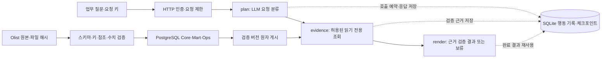

# Agentic Marketing Data Pipeline

**마케팅·커머스 지표를 신뢰할 수 있는 데이터로 만들고, AI가 그 근거를 조사하도록 연결한 프로젝트입니다.**

“유입은 있는데 계약으로 이어지지 않는가?”, “계약한 판매자의 주문이 보이지 않으면 판매가 없는가?”
이런 질문에 답하려면 숫자를 집계하는 것에서 더 나아가 분모, 데이터 연결 범위, 누락과 실패 이력을 확인해야 합니다.
잘못 연결한 데이터나 불완전한 표본을 그대로 설명하면 AI도 잘못된 의사결정을 도울 수 있습니다.

이 프로젝트에서는 **데이터를 정확하게 만드는 일과, AI를 업무에 유용하게 연결하는 일을 함께 고민했습니다.**
데이터 엔지니어링 관점에서는 원본 검증·마트·재처리·게시를 구현하고,
AI/AX 엔지니어링 관점에서는 업무 질문을 제한된 조사 작업으로 연결하는 서비스와 평가·운영 경계를 구현했습니다.
목표는 사용자가 모든 테이블과 SQL을 알아야 하는 부담을 줄이면서도,
**어떤 데이터로 판단했는지 확인할 수 있고, 근거가 부족하면 멈추는 조사 흐름**을 만드는 것입니다.

[도메인·지표 정의](docs/olist-metric-policy.md) · [AI 평가·오류 개선](docs/olist-boundary-fix.md) · [최신 배포·복구 검증](docs/olist-durable-release-20261012.md)

## 마케팅·커머스에서 해결하려는 문제

실제 데이터는 공개 **Olist 마케팅 리드·계약·커머스 표본**입니다.
분석 대상은 **판매자 유입 → 계약 → 표본에서 관측된 주문**이며, 소비자의 광고 클릭 → 구매 귀속 퍼널과 구분합니다.

| 업무에서 생길 수 있는 오해 | 설계 판단과 구현 | 확인한 범위 |
|---|---|---|
| 유입 경로가 없는 리드를 빼면 채널별 성과가 더 좋아 보일 수 있음 | `origin`이 NULL인 리드도 전체 분모에 포함하고 누락을 별도 표시 | 리드 8,000건 중 유입 경로 누락 60건 확인 |
| 계약 판매자의 주문이 연결되지 않으면 판매 0건으로 해석할 수 있음 | 서로 다른 표본의 연결 한계를 보존. 미연결 주문수는 `NULL`·`unlinked_unknown`으로 표현 | 계약 842건 중 연결 380건, 미연결 462건을 구분 |
| 주문상품을 조인한 뒤 행 수를 세면 주문수가 늘어남 | 판매자별 `DISTINCT order_id`로 집계하고 집계 단위를 명시 | 판매자별 관측 주문수 제공. 여러 판매자의 합계를 전체 고유 주문수로 해석하지 않음 |
| 숫자 컬럼이 있으면 ROAS·순매출·계약 후 30일 실적도 계산할 수 있다고 생각함 | 광고비·환불·통화·시간대·관측 완전성의 근거가 없는 지표는 제공하지 않음 | 표본 내 리드·계약·연결·누락·관측 주문수로 제공 범위 제한 |
| 새 배치가 실패하면 기존 분석 결과도 불안정해짐 | 검증된 버전만 원자적으로 게시하고 실패 이력은 별도로 기록 | 동일 버전 재사용, 실패 시 기존 게시 보존, 실제 DB 복원 검증 |

예를 들어 **“주문이 연결되지 않은 계약은 얼마나 되나?”**라는 질문에는 `462/842`와 게시 버전·근거를 제공합니다.
이 결과를 “판매하지 못한 계약 462건”으로 바꾸지 않습니다. 표본 간 연결이 되지 않은 것과 실제 판매가 없는 것은
다른 문제이기 때문입니다. 마찬가지로 관측된 주문수는 취소 등을 포함하며, 완료 주문이나 매출을 뜻하지 않습니다.

## AI를 업무 조사에 어떻게 활용했는가

AI의 역할을 **질문 해석 → 허용된 조사 범위 선택**으로 정했습니다.
실제 조회, 숫자 검증, 응답 구성과 실행 권한은 애플리케이션이 담당합니다.

| AI/AX 관점의 고민 | 서비스에 반영한 방식 |
|---|---|
| 사용자가 내부 테이블·SQL을 몰라도 업무 질문을 할 수 있을까? | NVIDIA Nemotron Super가 질문을 고정된 조사 의도로 분류하고, 호스트가 허용된 읽기 전용 도구로 연결 |
| 답변을 업무 판단에 사용하기 전에 무엇을 확인해야 할까? | 데이터 품질·게시 버전·분자와 분모·근거 ID를 확인한 구조화 결과 제공. 모델이 임의 SQL이나 수치를 만들지 않도록 분리 |
| 답할 수 없는 질문도 올바르게 처리할 수 있을까? | 지원 범위 밖 질문, 근거 부족, 쓰기·삭제 요청을 구분해 보류. 보류했어도 이유가 틀리면 평가 실패 |
| 모델 품질을 감각적인 프롬프트 수정으로만 개선해도 될까? | 실패 보존 → 원인 가설 → 후보 고정 → 회귀·새 문항·반복 평가. 기대값은 후보 실행 전에 고정 |
| API 호출 도중 장애가 나거나 사용자가 다시 요청하면 어떻게 될까? | LangGraph 진행 상태와 SQLite 행동 기록을 함께 보존. 완료 결과 재사용, 호출 전 예산 예약, 결과 미확정 호출의 자동 재전송 차단 |
| 외부에서 사용하는 AI 서비스에는 어떤 통제가 필요한가? | HTTPS·Bearer 인증, 본문 읽기 전 인증, 요청 키·호출량·본문·대기열·시간 제한, 요청 ID 기반 로그와 상태 확인 |

이 흐름은 데이터 확인과 근거 수집을 반복 가능한 서비스로 만드는 AX 시도입니다.
광고 예산 변경이나 데이터 수정을 자동 실행하는 에이전트는 구현하지 않았습니다.
실제 현업 사용자의 조사 시간 단축이나 의사결정 개선 효과도 아직 측정하지 않았습니다.

NVIDIA **Nemotron-Personas-Korea는 평가 질문을 다양화하는 공개 합성 페르소나 데이터**이고,
**Nemotron Super는 요청을 분류하는 추론 모델**입니다. 모델 파인튜닝을 수행한 것은 아닙니다.
원격 모델에는 분류 지침과 질문을 보내며, DB 행·SQL·연결 정보는 보내지 않습니다.

## 데이터부터 AI 서비스까지의 구조



- **데이터 제품:** PostgreSQL Core/Mart/Ops에 데이터·지표·품질·실행 이력을 구분합니다. 원본·계약·변환 해시로 버전을 식별하고, 조사 근거를 같은 읽기 스냅샷에서 수집합니다.
- **영속 조사:** LangGraph의 `plan → evidence → render`와 별도 행동 기록을 연결합니다. 체크포인트만으로 외부 API의 완료 여부를 단정하지 않으며, 결과를 안전하게 저장하지 못한 호출은 자동 재시도하지 않습니다.
- **운영 경계:** 단일 호스트에서 실행 소유권과 호출 예산을 관리합니다. 모델에 판단을 맡기는 범위와 시스템이 강제하는 권한·검증을 분리합니다.
- **배포·복구:** EC2/Caddy, 비공개 PostgreSQL RDS, 암호화 EBS, 비공개 S3로 단기 검증했습니다. 복원 후에는 데이터뿐 아니라 저장된 조사 결과와 소비한 호출 예산도 확인했습니다.

[영속 조사·API 설계](docs/olist-durable-service.md) · [데이터 계보와 실행 이력](docs/olist-lineage.md) · [AWS 구성·운영 절차](docs/aws-release.md)

## 실제 데이터와 합성 실험의 구분

Olist에 없는 광고비·환불 데이터를 실제 값처럼 채우지 않고, 별도 합성 데이터 경로에서 처리 문제를 검증했습니다.

| 경로 | 다루는 문제 | 현재 결과 |
|---|---|---|
| 실제 Olist / PostgreSQL | 판매자 유입·계약·표본 주문의 연결, 누락·관측 범위, 근거 기반 조사 | 원본 검증·마트·AI HTTP 조사·영속 재개·AWS 복구 검증 |
| 합성 마케팅 / DuckDB·Parquet | 광고비·주문·환불의 중복, 일대다 조인에 따른 금액 증폭, 정정·지연 도착·과거 재계산 | 데이터 계약·Bronze/Silver/Gold·원자 게시·결정론적 진단 검증. 별도 Qwen 모델 실험은 품질 0/3으로 실험용 유지 |

합성 경로에서는 환불을 주문별로 먼저 집계하고, 주문을 캠페인·일자별로 집계한 뒤 광고비와 연결합니다.
원본을 한꺼번에 조인해 광고비나 주문 금액이 부풀어 오르는 문제를 막기 위한 순서입니다.
늦게 도착한 환불은 정의한 정책에 따라 원주문 날짜를 재계산하며, 원천 완료 정보가 부족하면 확정 ROAS를 보류합니다.
이는 합성 계약 아래의 검증이며 실제 광고 플랫폼 연동이나 광고 성과 개선 실적은 아닙니다.

[합성 데이터 계약·계산 방식](docs/marketing/data-product.md) · [성공·실패 및 모델 실험 결과](docs/marketing/results.md)

## 검증 결과와 현재 상태

**2026-10-12 기준: 구현·단기 AWS 검증을 마쳤고, 검증용 AWS 리소스·백업·임시 API DNS는 삭제했습니다. 상시 운영 API는 없습니다.**

| 검증 | 확인한 결과 | 근거 |
|---|---|---|
| 코드·실제 PostgreSQL 통합 | 로컬과 GitHub CI에서 731개 테스트, 건너뜀 0; Ruff 통과 | [릴리스 기록](docs/olist-durable-release-20261012.md), [CI](https://github.com/masondev1024/agentic-marketing-data-pipeline/actions/workflows/ci.yml) |
| 제한된 요청 분류 품질 | 기존 회귀 24/24, 새 경계 문항 16/16, 주요 거절 반복 24/24 | [실패 후보·수정·평가 범위](docs/olist-boundary-fix.md) |
| 실제 Super HTTP | 미연결 계약 462/842, 유입 경로 누락 60/8,000을 독립 조회와 대조 | [HTTPS 영수증](evidence/olist-durable-aws-20261012/aws-http.json) |
| 재시작·장애 주입 | 동일 요청의 결과·예산 유지. 워커 강제 종료 후 불확실한 원격 호출 재전송 차단 | [재시작](evidence/olist-durable-aws-20261012/aws-restart.json), [장애 주입](evidence/olist-durable-aws-20261012/worker-fault.json) |
| 백업·복원 | S3 백업으로 복원한 14개 테이블·뷰의 행 수·내용 지문 일치. 조사 기록·예산 보존 후 복원본 API의 재생·신규 조사 2건 검증 | [복구 보고서](docs/olist-durable-release-20261012.md) |
| 비용·종료 | 승인 예산 USD 5의 단기 검증 후 생성 리소스·백업 삭제, 21개 확인 항목 통과 | [삭제 확인](evidence/olist-durable-aws-20261012/cleanup.json) |

분류 평가 점수는 제한된 문항의 결과이며 일반 답변 정확도를 뜻하지 않습니다.
복원은 **같은 RDS의 별도 DB와 같은 EC2의 새 SQLite 경로**에서 검증했습니다.
다중 인스턴스, 새 호스트 재난 복구, 자동 장애 조치, RPO/RTO·HA·SLA는 이번 검증 범위에 포함하지 않습니다.
단기 사용 요금은 리소스 삭제 이후 반영될 수 있습니다. [날짜별 구현 상태](docs/olist-status.md)에서 과거 결과와 현재 범위를 구분합니다.

## 실행과 재현

Python 3.12와 `uv`가 필요합니다. 내부 Python 패키지·CLI 이름은 기존 호환성을 위해 `llm-ops-lab`을 유지합니다.

```sh
git clone https://github.com/masondev1024/agentic-marketing-data-pipeline.git
cd agentic-marketing-data-pipeline
sh scripts/bootstrap.sh
uv run --locked pytest -q
uv run --locked ruff check .
```

bootstrap은 실제 Python 환경을 `work/python-env`에 두고 `.venv`를 연결합니다. 일부 macOS
환경에서 숨김 디렉터리의 editable 설치가 무시되는 문제를 피하기 위한 구성입니다.
이미 `.venv`가 있다면 스크립트가 임의 교체하지 않으므로 [환경 점검](docs/local-llm-guide.md)을 먼저 확인하세요.
기본 테스트에는 모델 다운로드나 API 키가 필요 없습니다. PostgreSQL 통합 검사는 전용 테스트 DB
설정이 없으면 건너뛰며, GitHub Actions에서는 격리된 PostgreSQL을 띄워 실행합니다.
실제 모델 품질·AWS 배포는 CI의 모의 검사와 구분해 별도로 검증합니다.

1. [데이터 출처·준비](docs/olist-preparation.md), [출처와 공개 범위](docs/data-attribution.md)
2. [Docker PostgreSQL·원본 검증·마트·로컬 복구](docs/olist-docker.md)
3. [Nemotron Super HTTP 연결](docs/olist-nvidia-http.md), [영속 조사·인증된 공개 모드](docs/olist-durable-service.md)
4. [로컬 Qwen/MLX·검색·HTTP](docs/local-llm-guide.md), [합성 마케팅 경로](docs/marketing/README.md)
5. [브랜치·CI 검증 범위](docs/github-workflow.md)

기본 API는 loopback 전용이며 로컬 추론은 Apple Silicon의 MLX를 사용합니다.
Super HTTP 경로는 `--olist-engine intent-v1 --olist-provider nvidia-super`로 명시적으로 선택합니다.
공개 모드는 HTTPS 프록시·인증·영속 원장을 함께 설정해야 합니다. 과거 단계 문서의 실행 예시와
현재 배포 상태가 다를 수 있으므로 최신 운영 범위는 위의 2026-10-12 릴리스 기록을 기준으로 봅니다.

원본 CSV·DB·모델 가중치·API 키는 저장소에 포함하지 않습니다. 외부 데이터는 출처에서 별도로
확보하고 계약 검사를 거쳐야 합니다. 프로젝트 자체 코드에 별도 오픈소스 라이선스를
아직 부여하지 않았으며, 외부 자료에는 각 자료의 라이선스가 적용됩니다.
