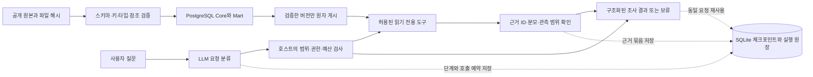

# Agentic Marketing Data Pipeline

**마케팅 지표가 달라졌을 때, 실제 성과 변화와 데이터 처리 문제를 구분할 수 있는 조사 시스템을 만듭니다.**

매출이나 전환율이 떨어졌다는 숫자만으로 원인을 설명할 수는 없습니다. 수집 지연, 중복 처리,
조인으로 늘어난 금액, 서로 다른 표본 범위도 지표를 바꿉니다. 데이터가 없는 상태를 0으로
채우면 그럴듯하지만 잘못된 판단으로 이어집니다.

이 프로젝트는 이 문제를 두 층으로 풀고자 시작했습니다. 먼저 원본부터 지표까지의 계약과
검증·복구 경로를 만들고, 그 위에서 AI가 필요한 조사 범위를 선택하도록 합니다.
AI가 자연스러운 설명을 만드는 능력보다 **어떤 근거를 확인했고, 무엇은 알 수 없는지
구분하는 능력**을 우선합니다.

## 해결하려는 질문

- 유입 경로가 없는 리드는 퍼널 집계의 분모에서 사라지지 않았는가?
- 계약한 판매자의 주문이 보이지 않는 이유가 0건 판매인가, 서로 다른 표본의 연결 한계인가?
- 파이프라인 실패 기록으로 확인할 수 있는 사실과 추가 로그가 필요한 원인은 어디서 나뉘는가?
- 모델이 잘못된 요청을 하거나 처리 중 중단돼도 데이터와 기존 게시 결과를 보존할 수 있는가?

실제 데이터 경로에서는 공개 **Olist 마케팅 리드·계약·커머스 표본**을 사용합니다.
이는 판매자 유입 → 계약 → 관측 주문의 관계이며 소비자의 광고 클릭 → 구매 귀속 퍼널이 아닙니다.
광고비·환불 장애 시나리오는 별도의 합성 데이터 경로에서 검증합니다.

## 구조



| 구성 | 선택한 방식과 이유 |
|---|---|
| 데이터 계약 | 원본 SHA-256, grain, 후보 키, 참조 관계, 지표 정의를 고정해 조용한 의미 변경을 막음 |
| 데이터 제품 | PostgreSQL의 검증된 버전만 게시하고, 재처리·부분 실패에서 기존 게시 결과를 보존 |
| Agent | 모델은 제한된 조사 의도를 분류하고, 호스트가 도구와 결과를 결정. 임의 SQL·외부 쓰기는 허용하지 않음 |
| 평가 하네스 | 형식·도구 범위 검사와 의미 검사를 분리. 안전하게 보류했어도 사유가 틀리면 실패 |
| 개선 루프 | 실패 보존 → 원인 가설 → 후보 고정 → 회귀·별도 문항·반복 검증. 결과를 보고 정답 기준을 바꾸지 않음 |
| 그래프 | Olist의 분류 → 근거 수집 → 결과 구성 단계를 영속화. 중단 후 결과 재사용과 호출 예산 보존; 결과 불명 호출은 자동 재전송 차단 |
| 서비스 | HTTPS·Bearer 인증, 본문 읽기 전 인증, 요청 키·호출량·대기열·시간 제한, 프로세스 회수·재시작 |
| 복구 | AWS의 비공개 RDS와 SQLite 백업을 S3에서 복원하고, 행 수·내용 지문·호출 예산 및 실제 API 재기동을 검증 |

NVIDIA **Nemotron-Personas-Korea는 평가 질문의 다양성을 위한 공개 합성 페르소나 데이터**입니다.
추론 모델인 **Nemotron Super**와 역할이 다르며, 이 프로젝트에서 파인튜닝을 수행한 것은 아닙니다.

## 검증과 현재 범위

[최신 정확성 수정·검증 보고서](docs/olist-boundary-fix.md)에 성공과 실패, 평가 범위를 함께 기록합니다.
[전체 구현 상태](docs/olist-status.md)에서는 이전 실험과 현재 결과를 구분합니다.

- Olist 원본 검증·마트·읽기 전용 진단과 로컬 HTTP 경로를 구현했습니다.
- 로컬 추론은 Apple Silicon의 Qwen3-4B/MLX, NVIDIA Super는 명시적으로 선택하는 원격 평가·HTTP 조사 경로입니다.
- 기본 연결은 loopback이며, 공개 모드는 HTTPS 프록시·인증·영속 원장을 함께 요구합니다. 원격 Super는 `intent-v1`을 명시해 선택합니다.
- 통화·시간대·관측 완전성이 확정되지 않은 재무·30일 귀속 지표는 제공하지 않습니다.
- PostgreSQL을 포함한 로컬 테스트 731개와 실제 Super HTTP 집계·재요청·재시작을 검증했습니다.
- AWS 단기 배포·장애 주입·백업 복원을 검증한 프로젝트입니다. 실제 고객 운영, 고가용성, SLA 또는 자유로운 원인 추론의 정확성을 주장하지 않습니다.

실행 원장과 체크포인트의 차이, 불명확한 외부 호출의 처리, 단일 호스트 한계는
[영속 조사 서비스](docs/olist-durable-service.md)에 정리했습니다. 클라우드 구성·복구·비용 및
정리 절차는 [AWS 검증 안내](docs/aws-release.md), 실측 결과는
[배포·복구 검증 보고서](docs/olist-durable-release-20261012.md)를 참고하세요.

## 실행

Python 3.12와 `uv`가 필요합니다. 내부 Python 패키지·CLI 이름은 기존 호환성을 위해 `llm-ops-lab`을 유지합니다.

```sh
git clone https://github.com/masondev1024/agentic-marketing-data-pipeline.git
cd agentic-marketing-data-pipeline
sh scripts/bootstrap.sh
uv run --locked pytest -q
uv run --locked ruff check .
```

bootstrap은 실제 Python 환경을 `work/python-env`에 두고 `.venv`를 연결합니다. 일부 macOS
환경에서 숨김 디렉터리의 editable 설치가 무시되는 문제를 피하기 위한 구성입니다.
이미 `.venv`가 있다면 스크립트가 임의 교체하지 않으므로 [환경 점검](docs/local-llm-guide.md)을 먼저 확인하세요.
기본 테스트에는 모델 다운로드나 API 키가 필요 없습니다. PostgreSQL 통합 검사는 전용 테스트 DB
설정이 없으면 건너뛰며, GitHub Actions에서는 격리된 PostgreSQL을 띄워 실행합니다.
실제 모델의 답변 품질은 별도의 실추론 평가로 검증합니다.

1. [Docker PostgreSQL·원본 검증·마트·복구](docs/olist-docker.md)
2. [실제 데이터 출처·지표 해석](docs/olist-preparation.md), [출처와 공개 범위](docs/data-attribution.md)
3. [조사 API 사용법](docs/olist-agent-service.md), [NVIDIA 모델 선택](docs/olist-nvidia-model-selection.md)
4. [로컬 LLM·검색·HTTP 실습](docs/local-llm-guide.md), [합성 마케팅 경로](docs/marketing/README.md)
5. [브랜치·CI 검증 범위](docs/github-workflow.md)

원본 CSV·DB·모델 가중치·API 키는 저장소에 포함하지 않습니다. 외부 데이터는 출처에서 별도로
확보하고 계약 검사를 거쳐야 합니다. 프로젝트 자체 코드에 별도 오픈소스 라이선스를
아직 부여하지 않았으며, 외부 자료에는 각 자료의 라이선스가 적용됩니다.

### Nemotron Super HTTP 연결

조사 API에서 Super를 명시적으로 선택할 수 있습니다. 질문 분류만 원격으로
보내고, 읽기 전용 조회와 근거 검증은 호스트에서 수행합니다. 실행 방법과 호출 예약 상한,
실패 처리 범위는 [HTTP 연결 안내](docs/olist-nvidia-http.md)를 참고하세요.
