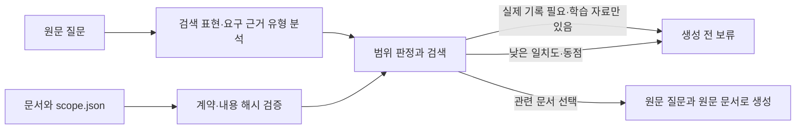

# 실습 7 — 검색 질의와 근거 범위 분리

## 결과

설계·구현·실제 생성 검증을 완료했다. 새 방식은 --retriever scoped-v2로 선택한다.
기본값은 기존 baseline이며, 신규 정책의 한계를 확인하면서 사용할 수 있게 분리했다.

| 검색 선택/보류 일치 | baseline | scoped-v2 (최종 query-scope.v2) |
|---|---:|---:|
| 기존 개발 20문항 | 18/20 | 20/20 |
| 추가 검증 20문항 | 14/20 | 15/20 |
| 추가 셋: 문서가 있는 질문 | 5/10 | 5/10 |
| 추가 셋: 보류해야 하는 질문 | 9/10 | 10/10 |

최종 비교에서 이전에 통과한 문항의 퇴행은 없었다. 하지만 추가 셋의 관련 문서 누락 5건은 남았다.
말만 조금 바꾼 시간/횟수·일반 원리 질문에도 누락이 있어, 범위 판정 개선을 검색 전반의 완성으로
해석하면 안 된다. 추가 셋은 같은 작성자가 만든 검증 문항이며 수정 과정에서 개발에 사용됐다.

실제 4B 생성에서는 첫 재시도 간격 질문에
'제공된 참고 문서에는 첫 재시도 간격이 정확히 몇 초인지에 대한 정보가 없습니다.'라고 답했다.
값을 날조하지 않았지만 한 문장이라 두 문장 형식은 실패했다.
실제 회사 백필 실행 ID 질문은 unsupported_evidence_scope로 생성 전에 보류했다.

기존과 달라지지 않아야 할 17문항은 실제 메시지와 출력이 이전 4B 배치와 같음을 확인했다.
변경된 세 문항은 위 두 사례와 실제 회사 장애 질문의 보류 안내문이다.
assistant 수동 채점에서 문서가 있는 15문항의 내용+근거 충족은 10/15에서 11/15가 됐다.
형식은 새로 생성한 문항까지 포함해 9/15이며, 기존 9/14와 분모가 다르다.
검색 20/20은 답변 정확도 100%를 뜻하지 않는다.

pytest 79개와 Ruff 통과. 실제 모델 생성 배치에서 실행 오류는 0/20이다.
계약 누락·변조/미갱신·잘못된 종류, 일반 설계 vs 실제 기록, 생성 전 모델 import 금지,
메타데이터 사본/옵션 전달, 동점 보류와 파일명 변경에 대한 동작을 검증했다.

- 최종 개발 baseline 검색: 915f24cb-ce1a-427b-864c-c2989b4965ce
- 최종 개발 scoped-v2 검색: bccfcf06-3f75-4a97-8fec-a2d0da06af38
- 최종 추가 baseline 검색: b4c9107f-5341-4b90-a001-e07ec97165d8
- 최종 추가 scoped-v2 검색: ac755b8e-8339-41d7-bcd4-5ce63dd1ef87
- scoped-v2 실제 생성: 78fed1aa-d0b1-41b8-bfa4-80808e110764

[최초 실패·최종 비교·수동 채점 증거](../evidence/day07-assistant-retrieval-scope.json)

## 설계

기존 검색 점수는 단어 일치 정도만 나타낸다. 주제가 같다는 이유만으로 학습용 문서를
실제 회사 상태나 특정 실행 기록의 근거로 사용할 수는 없다.



기존 baseline은 그대로 선택 가능하다. 새로운 경로는 --retriever scoped-v2로 명시한다.
원문의 데이터와 모델/프롬프트는 바꾸지 않았다. 실제 범위 판정은 아래의 제한된 규칙에 의존한다.

## 문서 계약

data/runbooks/scope.json은 corpus-scope.v1 형식이며 다음을 선언한다.

- evidence_kind=synthetic_reference: 이 집합은 학습용 참고 자료다.
- documents: 문서 파일명과 원문 SHA-256의 정확한 대응표다.

scoped-v2는 계약이 없거나 스키마/근거 유형이 다르거나 문서 집합·내용 해시가 바뀌면 오류를 낸다.
현재 지원하는 근거 유형은 synthetic_reference 하나다. 실제 운영 기록 지원을 가장하기 위해
임의로 production_record를 적어 넣는 방법은 허용하지 않는다.

문서를 수정·추가·삭제하면 계약도 검토·갱신해야 한다. 자동으로 새 파일을 학습용이라고
추정하거나 오래된 메타데이터를 묵인하지 않는다. 해시는 '이 메타데이터가 이 내용에 붙어 있다'는
일관성을 검증할 뿐 실제 출처의 진위나 사실성을 증명하지 않는다. 분류는 자료 관리자의 책임이다.

평가 실행기는 문서와 계약을 함께 복사하고 scope_sha256을 남긴다. 각 문항에서도 같은 계약인지
검사한다. 기존 corpus_sha256은 원문 문서의 해시이고 scope_sha256은 별도 메타데이터 해시다.
원문 파일 사본과 동일하게 여러 파일 복사 전체의 원자성까지 보장하지는 않는다.

## 질의 처리

모델에는 원래 질문을 그대로 전달한다. 검색용 문자열에서만 정확히/정확한 및 몇 초/분/시간/회/번과
일부 의문형 어미를 제거한다. 질문에 필요한 단위를 답변 프롬프트에서 없애지 않는다.
최소 coverage=0.5와 동점 보류 기준은 유지한다.

질문의 회사·팀 소유 표현, 날짜/시점, 구체적인 실행 ID, 실행 경로·횟수·처리 건수 등의 요청과
설계·정의·이유 같은 일반 설명 표현을 조합해 실제 기록 필요 여부를 판단한다.
예를 들어 '우리 회사에서 백필 실행 ID를 왜 기록해야 하나요?'는 일반 설계 질문으로 남기지만,
'우리 회사 백필의 지난 실행 ID는?'는 실제 기록이 필요하므로 생성 전에 보류한다.
일반 원리와 실제 기록을 함께 요구하는 질문은 전체 보류한다. 부분 답변은 이번 범위에 없다.

retrieval.query_analysis에 정책 버전, 감지 신호, 원래 검색어와 검색용 문자열을 남긴다.
고정 정규식은 자연어의 모든 의미·동의어·부정을 이해하지 못한다. 소유자나 대상 필드의 새로운
표현은 놓칠 수 있고, 복합 질문이나 인용 문장에서 과도하게 보류할 수도 있다.
접근 제어·보안 경계·완전한 근거 충족 검사로 사용하면 안 된다.

## 실패와 복구 구분

| 상황 | 결과 | 운영 의미 |
|---|---|---|
| 계약 누락·오래된 해시·잘못된 파일 | CLI 오류, 종료 코드 1 | 입력 데이터/메타데이터 문제를 수정해야 함 |
| 실제 실행 기록 요구 + 학습 자료 | unsupported_evidence_scope, 모델 미실행 | 해당 근거를 가진 자료가 필요함 |
| 단어 일치 부족·동점 | 기존 검색 보류, 모델 미실행 | 검색 누락/모호성을 별도로 분석 |
| 관련 문서에 구체적 값이 없음 | 문서와 원래 질문으로 생성 | 모델이 정보 부족을 제대로 답하는지 검토 |

관련 문서를 찾았다고 구체적 값이 있다고 보장하지 않는다. 검색 이후 사실 날조는 별도의
생성 품질 문제다. --context-file 직접 입력 경로는 이 corpus 범위 정책을 적용하지 않는다.

## 실행

```sh
uv run --locked llm-lab --corpus-dir data/runbooks --retriever scoped-v2 \
  --search-only --prompt '이 재시도 문서에서 첫 재시도 간격은 정확히 몇 초인가?'

uv run --locked python -m llm_ops_lab.evaluation --offline \
  --model qwen3-4b --retriever scoped-v2 --prompt-variant baseline \
  --temperature 0 --max-tokens 256 --seed 42

uv run --locked python -m llm_ops_lab.evaluation --search-only \
  --retriever scoped-v2 --dataset data/eval/retrieval-challenge-v1.jsonl
```

모든 --retriever 옵션을 생략하면 기존 baseline이다. baseline도 scope.json이 존재하면
계약의 일관성을 확인하지만 없을 때 필수로 요구하지 않으며, 범위 차단/검색 표현 정제는 하지 않는다.
새 검색 방식으로 만든 결과도 별도 UUID에 저장하므로 기존 기록을 덮지 않는다.

## 평가셋의 경계

기존 개발 20문항은 수정하지 않았다. 추가 검증 20문항은 첫 실행 전에 고정했지만 같은 assistant가
작성해 내용을 알고 있으므로 독립 held-out이 아니다. 첫 실행에서 규칙 버그를 발견해 회귀 테스트로
사용했으므로 현재는 개발에 사용된 검증셋이다. 공개하지 않은 테스트셋을 완성했다고 주장하지 않는다.

첫 query-scope.v1은 '설정의' 안의 '정의'를 개념 질문 신호로 잘못 감지했다.
기존 개발셋은 20/20이었지만 추가 셋은 baseline과 같은 14/20이었다. 날짜 질문에서 1건 개선,
회사 설정 질문에서 1건 퇴행이 있었다. 해당 결과를 삭제하지 않았다.
단어 경계 버그만 query-scope.v2로 수정하고 설정의/정의는 양쪽 회귀 테스트를 추가했다.
추가 셋의 나머지 검색 누락에 맞춰 규칙·임계값·정답을 수정하지 않았다.
