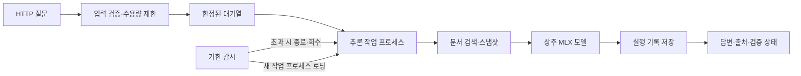

# 로컬 LLM HTTP API — 호출·과부하·복구 검증

2026-10-07 KST, CLI에 있던 검색·추론을 HTTP 서비스로 연결했다.
이번 단계는 **로컬 서비스 구현과 장애 경로 검증**이며 외부 배포나 실제 사용자 운영이 아니다.
`day-11`은 학습 단계 번호다. 모델·검색·프롬프트의 품질 개선 실험은 추가하지 않았다.

## 직접 실행

프로젝트 루트의 첫 터미널에서 서버를 실행한다. 기존 캐시의 고정 Qwen3-4B를 사용하며,
서버는 모델을 자동 다운로드하지 않는다. 캐시가 없으면 readiness가 실패한다.

```sh
uv run --locked --extra local llm-lab-serve
```

다른 터미널에서 준비 상태를 확인한다. 로딩 중에는 live가 200이어도 ready는 503일 수 있다.

```sh
curl -sS http://127.0.0.1:8000/health/live
curl -sS http://127.0.0.1:8000/health/ready
```

ready가 200이고 `ready: true`이면 질문한다.

```sh
curl -sS http://127.0.0.1:8000/v1/answers \
  -H 'Content-Type: application/json' \
  -d '{"question":"멱등성은 같은 작업을 여러 번 수행할 때 최종 효과에 어떤 성질을 보장하나?","max_tokens":256}'
```

범위 밖 질문의 보류도 확인한다.

```sh
curl -sS http://127.0.0.1:8000/v1/answers \
  -H 'Content-Type: application/json' \
  -d '{"question":"오늘 서울 날씨와 기온은?"}'
curl -sS http://127.0.0.1:8000/metrics
```

첫 질문은 `status: generated`, 날씨 질문은 `status: abstained`, `model_executed: false`가
관찰 대상이다. 답변 문구 자체는 정답으로 가정하지 않는다. 종료는 서버 터미널에서 `Ctrl+C`다.
assistant가 실행한 검증 서버는 종료했으므로 직접 실습할 때 위 명령으로 시작하면 된다.

## 요청·응답 계약

| 요청 필드 | 기본값·제약 |
|---|---|
| question | 필수, 공백만 금지, 최대 4,096자, 유효한 UTF-8 |
| max_tokens | 256, 정수 1~512 |
| temperature | 0, 유한한 수 0~2 |
| seed | 42, 정수 0~2³²−1 |
| answer_mode | direct 또는 evidence-v1; 기본 direct |

알 수 없는 필드, 문자열로 보낸 숫자, 중복 JSON 키, 비정상 JSON을 거절한다.
요청자가 모델 경로·문서 경로·시스템 메시지를 지정할 수 없다.
원시 본문은 24 KiB, 본문 수신 시간은 5초, 렌더링한 모델 입력은 단계별 2,048토큰까지다.
본문 길이 헤더가 없는 chunked 요청에도 바이트 제한을 적용한다.

응답에는 request ID, status, answer, sources, citations, 모델 ID/revision, 토큰 수,
대기/생성/요청 시간, truncation 및 검증 상태가 들어간다. `sources`는 검색 문서의 출처이고,
`citations`는 evidence 모드에서 검증한 원문 인용이다. direct 모드에서 인용은 빈 목록이다.
출처 이름에는 이 로컬 실험의 파일 경로가 포함된다. 외부 공유용 응답으로 설계하지 않았다.

`validation.semantic_quality`는 항상 `unverified`다. HTTP 200, JSON 검증, 원문 인용 일치는
서로 다른 사실이며 답변의 정확성을 보장하지 않는다. 출력이 토큰 한도에 도달하면 `truncated: true`다.

| HTTP 상태 | 의미 |
|---|---|
| 200 | 생성, 검색/근거 보류, 구조 검증에 의한 답변 차단; body.status로 구분 |
| 400/403/415 | 허용하지 않은 Host/비로컬 접속·Origin/Content-Type |
| 408/413 | 본문 수신 시간/크기 초과 |
| 422 | 요청 계약 또는 모델 입력 토큰 한도 초과; 모델 재시작 없음 |
| 429 | 추론 또는 HTTP 수용량 초과 |
| 503 | 로딩·복구·실패 상태, 복구 중 대기 요청 거절, 감사 로그 용량 초과 |
| 504 | 추론/대기 기한 초과 |
| 500 | 모델 내부 오류 또는 결과·로그 저장 실패; error.code로 구분 |

구조 검증 실패 `evidence_rejected`의 원시 생성문은 정상 답변으로 노출하지 않는다.
오류 응답은 질문·내부 파일 경로·스택 추적을 되돌려 주지 않는다.
Uvicorn 자체 연결 한도에 걸린 요청은 애플리케이션에 도달하지 않아 공통 request ID가 없을 수 있다.

## 왜 API와 모델 프로세스를 나눴나



HTTP 서버는 요청을 받고, 별도 프로세스가 모델을 한 번 로드해 순차 처리한다.
기본 용량은 **추론 1개 + 대기 2개**, 요청 기한은 대기를 포함해 60초다.
한 모델을 여러 요청이 동시에 사용해 메모리가 늘거나 seed 상태가 섞이는 것을 피한다.
API와 CLI는 같은 `InferenceRuntime`과 검색·생성 함수를 사용한다. 기존 CLI 기본값은 변경하지 않았다.

단순히 HTTP 대기를 취소하면 GPU 작업은 계속될 수 있다. 따라서 활성 요청의 기한을 넘으면
기존 worker를 종료하고 회수한 후 새 worker를 만든다. 종료에 응답하지 않으면 강제 종료한다.
옛 프로세스가 정리되기 전에는 새 모델을 띄우지 않는다. 그동안 대기 요청은 503으로 끝낸다.
요청을 자동 재실행하지 않으며, 작업 프로세스 재시작은 서버 실행당 최대 3회다.
초과하면 unavailable 상태로 남아 운영자가 원인을 확인하고 서버를 다시 시작해야 한다.

클라이언트 연결이 끊겨도 추론이 끝나거나 원래 기한에 도달하기 전에는 실행 자리를 내주지 않는다.
대기 중 취소되거나 만료된 요청은 모델로 보내지 않는다. 재요청에는 새 ID가 붙으며 추론 결과의
중복 실행 방지 저장소는 없다. 현재 읽기 전용 답변 서비스라 데이터 쓰기의 exactly-once를 주장하지 않는다.

FastAPI의 lifespan이 감독 작업의 시작·종료를 관리한다.
[공식 lifespan 설명](https://fastapi.tiangolo.com/advanced/events/)과 같은 자원 수명주기 원칙을 사용하되,
실제 MLX 로딩은 자식 프로세스 안에서 수행한다.

## 기록과 관측

- `runs/service/<request_id>.json`: 질문·답변·실제 모델 입력·문서/코드 해시·토큰·상태·worker PID.
- `<request_id>.stages.jsonl`: evidence 모드의 완료 단계 기록.
- `access.jsonl`: 질문 본문 없이 request ID, HTTP 상태, 결과/오류 코드와 시간.
- `worker.stderr.log`: 작업 프로세스의 로컬 진단 로그.
- `/metrics`: 현재 active/queued, accepted/completed, 과부하·시간 초과·worker 장애·재시작 횟수.

성공 응답 전에 실행 결과와 감사 로그 쓰기를 확인한다. 파일시스템 오류는 성공으로 위장하지 않는다.
로그 쓰기는 이벤트 루프 밖에서 직렬화하고, 취소된 요청의 진행 중인 쓰기를 포함해 최대 32개로 제한한다.
로그가 가득 찬 상황에서 과부하 거절을 다시 로그 대기열에 쌓지 않는다. 따라서 용량 거절 일부는
감사 파일에 남지 않을 수 있다. `/metrics`는 프로세스 재시작 시 초기화되는 로컬 카운터다.

원시 질문/답변 기록은 개인정보 비저장 설계가 아니다. 공개·합성 텍스트만 사용한다.
실행 결과 파일 저장과 완료 단계의 fsync를 구분하며, 정전에도 모든 파일이 원자적으로 보존된다는
보장은 하지 않는다. 작업 프로세스를 강제 종료한 요청은 최종 JSON 없이 HTTP 오류 로그만 남을 수 있다.

## 검증 결과

assistant가 실제 localhost TCP 서버와 캐시된 Qwen3-4B로 확인했다.
검증 설정은 기본값과 달리 **18765 포트, 추론 1개 + 대기 1개, 기한 30초**였다.

| 시나리오 | 확인한 결과 |
|---|---|
| 정상·동일 seed 반복 | HTTP 200, 동일 답변, 동일 worker PID 재사용 |
| 범위 밖·지시 무시/파일 읽기 형태 질문 | 검색 단계 보류, 생성 미실행 |
| evidence 모드 | HTTP 200, 원문 인용 verified, 의미 검증 unverified |
| 두 모드의 모델 입력 토큰 초과 | 422, worker PID와 재시작 횟수 유지 |
| 활성 1 + 대기 1에서 추가 요청 | 429; 앞의 두 요청은 각각 정상 완료 |
| 유휴 worker SIGKILL | 옛 PID 회수, 새 worker 준비 후 정상 생성 |
| worker SIGSTOP으로 실제 정지 | live 200 유지, 활성 요청 504, 대기 요청 503 |
| 정지 worker의 기한 만료 후 | SIGTERM 후 필요 시 kill, 옛 PID 회수, 새 worker 정상 생성 |
| 전체 서버 정상 종료·재시작 | 부모/worker 종료와 포트 닫힘, 새 서버 준비 후 실제 생성 |
| CLI 호환성 | 기존 질문의 메시지·입력 토큰 해시·설정·출력 일치 |

범위 밖 공격 형태 질문 하나를 막은 것이 모든 프롬프트 주입을 방어한다는 증거는 아니다.
모델 답변 품질의 일반화, 다수 사용자 부하, 서비스 p95, 외부 인증/배포는 검증하지 않았다.

전체 **236개 테스트 및 Ruff 통과**. 신규 테스트는 41개이며 테스트용 IPC worker로 입력/과부하,
기한/프로세스 장애/종료, 클라이언트 취소, 시작 실패와 재시작 상한, 저장 실패,
느린/가득 찬 감사 로그, 비로컬 접속을 확인했다. 이 모의 장애 테스트를 실제 모델 품질 증거로 쓰지 않는다.
Starlette TestClient의 httpx 사용에 대한 deprecation 경고 1개가 남았다. 현재 잠금 버전에서 통과했으며
테스트 클라이언트 업그레이드 시 별도 호환성 확인이 필요하다.

독립 리뷰에서 발견한 입력 초과의 불필요한 재시작, 직접 생성 실패의 기록 누락, 저장 오류 분류,
실제 접속 주소 확인, 감사 로그 쓰기 수용량 문제를 수정한 뒤 회귀 검증했다.
최종 코드 리뷰 APPROVE, 아키텍처 CLEAR다.

[실제 HTTP 응답·실행 기록·검증 조건](../evidence/day11-assistant-local-api.json)
[장애 시나리오와 QA 보고서](day-11-qa.md)

## 운영 범위와 다음 학습

서버는 127.0.0.1에만 바인딩하고 실제 peer IP도 확인한다. 인증 서버를 구현한 것은 아니므로
외부 proxy/터널에 연결하지 않는다. 브라우저 Origin이 있는 POST를 거절하며 이번 인터페이스는 curl/API
클라이언트 실습용이다. 이 서버를 다중 Uvicorn worker로 실행하면 모델도 여러 개 뜨므로 지원하지 않는다.

로그 보존 기간·회전·디스크 한도, 재시작을 담당할 OS supervisor, 독립 잠금 품질 평가,
응답의 의미 오류 개선, 외부 인증·비용 한도는 남은 운영 과제다. 특히 부모 API를 SIGKILL한 순간
이미 정지한 GPU worker까지 자동 회수하는 조건은 이번 검증 범위가 아니다.
소스 수정 시 서버를 재시작한다. 실행 중 코드 교체/자동 reload는 지원하지 않는다.

다음 직접 실습에서는 세 가지를 설명해 본다: live와 ready가 왜 다른지, 클라이언트의 시간 초과만으로
GPU가 비었다고 판단하면 안 되는 이유, HTTP 200과 올바른 답변을 왜 따로 평가해야 하는지.
