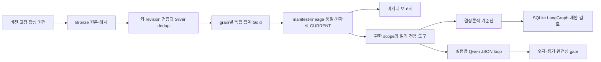

# 아키텍처와 ADR

광고 누적 스냅샷을 주문에 바로 조인하면 주문 수만큼 광고비가 늘어난다. 지연 환불은 과거
ROAS를 바꾸며, 불완전 수집은 실제 성과 하락처럼 보일 수 있다. 따라서 모델 앞에 숫자와
게시 상태를 검증하는 데이터 제품을 두었다. 범위는 로컬 합성 두 계정이며 운영 규모 측정은 없다.

그래프는 현재 결정론적 기준선을 감싼다. 모델 loop가 checkpoint로 재개된다는 주장은 하지 않는다.
기존 `/v1/answers`는 별도의 기존 RAG API이며 마케팅 기능을 그 API에 배포하지 않았다.

| ADR | 결정·이유 | 대안·비용·전환 조건 |
|---|---|---|
| 01 grain 우선 | 광고·주문·환불을 각각 정규화/집계 후 조인. 동일 버전 payload 충돌은 전체 게시 차단 | 원본 조인은 fanout 위험. 고정 캠페인 차원은 단순하지만 변경 이력은 v2/SCD 계약 필요 |
| 02 과거 일자 재작성 | 환불은 원주문 KST 일자의 순귀속매출을 감소. as_of가 진행하면 해당 전체 창 재계산 | 환불 발생일 회계 매출과 다름. 실제 재무 보고에는 별도 지표와 reconciliation 필요 |
| 03 불변 게시 | 검증된 Parquet+manifest를 완성한 후 포인터 교체. 실패는 이전 유효본 유지 | 로컬 POSIX single writer. 파일 전체 해시는 비용이 커 규모 증가 시 partition manifest 필요 |
| 04 증거 gate | 숫자는 SQL/Python, 모델은 allowlist 선택만 수행. 누락·0 지출·stale은 unknown | 자유 SQL/서술 진단보다 표현력은 좁지만 계정 격리와 사실 추적이 가능 |
| 05 모델 승격 분리 | 기준선과 같은 snapshot에서 실제 모델을 평가하고 실패를 공개 | 4B는 호출·지연 대비 품질 미달. 기본 진단은 결정론적 방식 유지, 새로운 비교는 사전 등록 |
| 06 재개 원장 | SQLite checkpoint 외에 pending/completed 원장을 저장해 모호한 crash를 terminal unknown으로 처리 | 가용성보다 예산·증거 보존 우선. DB 전체 flock으로 thread 병렬성 제한 |
| 07 local first | 현재 uv/Python/DuckDB/MLX/LangGraph만 사용. AWS는 선택 설계 | 운영 필요가 생기면 저장·인증·동시성·추론 이식 검증이 별도로 필요 |

[상세 계약](data-product.md), [도구 한도](diagnostic-interface.md),
[재개 실패 모델](graph-recovery.md)을 변경의 기준으로 삼는다. at-least-once 재전송은
키·revision으로 중복 제거하고 전체 창 replacement로 멱등성을 유지한다. CDC, 스트리밍,
Iceberg/Delta 테이블 커밋은 구현하지 않았다. 현재 작은 제품에서 분산 테이블 포맷의
운영 비용이 이점보다 크며, 다중 writer와 대용량 증분 갱신이 필요할 때 별도 검토한다.

품질 병목은 원천 coverage가 선언이라는 점이다. 완전성의 독립 증명에는 수집 receipt와
원천 control total이 필요하다. 성능 병목은 전체 창 재계산·파일 해시·단명 DuckDB worker,
복구 병목은 SQLite 단일 writer다. 이를 운영 처리량·SLA를 달성한 것으로 해석하지 않는다.
