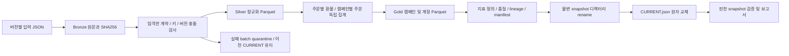

# 마케팅·커머스 데이터 제품 v1 — AC 2

권위 있는 요구사항은 `AGENTS.md`와 `work/marketing-aws-implementation-brief.md`의
산출물 1·2 및 산출물 6의 데이터 수용 사례다. 원문은 변경하지 않았다.
이번 구현 범위는 합성 데이터 → Bronze/Silver/Gold → 마케터 보고서이며, 모델·도구 루프·그래프는
이 문서의 완료 주장에 포함하지 않는다. 조력자가 구현·검증했으며 학습자의 직접 실행 증거는 별도다.

## 실행

```sh
uv run --locked python -m llm_ops_lab.marketing build \
  --input data/marketing/v1/development.json --output-dir runs/marketing/development
uv run --locked python -m llm_ops_lab.marketing report \
  --output-dir runs/marketing/development --now 2026-10-07T12:00:00Z
```

`--now`는 과거 합성 fixture를 재현하는 시계다. 생략하면 실제 UTC 현재 시각을 사용한다.
보고서에 override 여부를 표시하며 실제 최신 데이터라고 주장하지 않는다.
실패한 build/report는 stderr에 JSON 오류와 비영 종료 코드를 반환한다.
기존 `llm-lab` CLI 및 `/v1/answers`는 수정하지 않았다.

## 데이터 계약

실행 가능한 계약은 `src/llm_ops_lab/marketing/contracts.py`, 정의 버전은 `marketing.v1`이다.
`data/marketing/v1/contract.json`은 필드·키·정책의 검토용 기계 가독 표현이다.
합성 입력은 `development.json`, 별도 동결 수용 입력은 `acceptance.json`이다.
일반 난수 대신 고정 명세로 생성하여 실행마다 바이트가 같고 seed는 필요 없다.
두 split은 서로 다른 날짜·revision이지만 동일한 소규모 시나리오 구조를 공유한다.
미지의 운영 분포나 일반화 성능을 대표하지 않는다.

| 데이터 | grain / 식별자 | 선택 및 제약 |
|---|---|---|
| campaigns | account_id, campaign_id | 계정별 캠페인 차원. 동일 payload 중복 제거, 이름 충돌 차단 |
| spend_snapshots | account_id, source, snapshot_id, revision | snapshot_id는 campaign_id, business_date, snapshot_at을 불변으로 식별 |
| Silver spend | account_id, campaign_id, business_date | 가장 늦은 snapshot_at의 가장 큰 visible revision 하나 |
| orders | account_id, source, order_id, revision | 주문의 최신 visible revision. 캠페인·원주문 event_time 불변 |
| refunds | account_id, source, refund_id, revision | 환불 사건의 최신 visible revision. 원주문·event_time 불변 |
| coverage | account_id, business_date, source | spend/orders/refunds 세 원천 각각의 complete, through_utc |
| Gold campaign | account_id, campaign_id, business_date | 세 원천을 먼저 집계한 뒤 고유한 grain으로 조인 |
| Gold account | account_id, business_date | 캠페인 수치 합계. 비율을 평균하지 않음 |

모든 필드는 명시적으로 존재해야 하고 미등록 필드도 거절한다. 자동 타입 변환은 없다.
돈은 0..10^12 범위 정수 KRW이며 bool·float·문자열을 거절한다. 날짜는 ISO Asia/Seoul 일자,
시간은 UTC `YYYY-MM-DDTHH:MM:SSZ`로 고정한다. 정수 revision은 1..1,000,000이다.
source event_time ≤ ingested_at이며 광고 snapshot_at ≤ event_time이다.
광고 스냅샷 시간의 한국 날짜는 대상 일자보다 이르면 안 된다.

동일 버전의 업무 payload가 다르면 나중 데이터로 덮지 않고 전체 게시를 차단한다.
ingested_at만 다른 재전송은 최초 도착 시간을 보존한다. 충돌은 최신 버전에 가려져도 차단한다.
서로 다른 snapshot_id가 동일 계정·캠페인·일자·snapshot_at 위치를 주장해도 차단한다.
따라서 **동일 키·버전·payload, spend_krw=10000인 두 건 → Silver 1행, Gold 10000**이다.

alpha와 beta는 c1/order_id 일부를 의도적으로 공유한다. 계정 키가 빠진 조인은 수용 검증에서
잘못된 환불/매출을 발생시키므로 이를 검출한다. 캠페인 차원은 기간 내 고정이며 SCD는 v1 비범위다.
원천 schema 진화는 v2 계약 및 명시적 변환이 필요하다. 미지 필드를 자동 수용하지 않는다.

## 단독 spend 진입점 호환성 (AC 2 재검증)

`process_spend_snapshots(spend_snapshots)`는 기존 내부 번들 행과 별도로,
자체 메타데이터를 가진 단독 v1 행을 지원한다. 두 형식을 한 호출에서 섞으면 거절한다.
내부 번들 계약과 동결 acceptance 파일은 변경하지 않았다.

단독 행의 필수 필드는 `schema_version`, `fixture_version`, `snapshot_id`, `account_id`,
`campaign_id`, `business_date`, `spend_krw`, `currency`, `complete`, `event_time`,
`ingestion_time`, `as_of` 및 정수 revision이다. 명시적으로 지원하는 revision 이름은
`source_revision`, `revision`, `snapshot_version`, `source_version` 중 정확히 하나다.
`source`는 선택 필드이고 생략 시 spend 원천이다. 미등록 필드는 거절한다.
지원 schema 표기는 `spend.v1`, `spend_snapshot.v1`, `spend_snapshots.v1`이며
다음 버전을 자동 수용하지 않는다. 이는 이 어댑터의 공개 호환 정책이다.

이 형식의 `as_of`는 원천 스냅샷 위치다. 번들의 조회 시점과 구분하며
`event_time ≤ as_of ≤ ingestion_time`으로 검증한다. 따라서 as_of보다 늦게 수집된
단독 행을 잘못 제외하지 않는다. 날짜는 KST, 시간은 UTC, currency는 KRW다.
complete는 원천 선언만 보존하며 단독 광고비만으로 커머스 ROAS를 확정하지 않는다.

Silver는 전체 메타데이터를 보존하며, 동일 식별자·revision에서 ingestion_time 이외의
payload 변경은 충돌이다. 재전송은 최초 ingestion_time을 남긴다. 최신 as_of·revision의
행을 계정·캠페인·일자별로 선택한 뒤 SQL로 Gold를 만든다. 공개 반환값은 `silver_row_count`, `gold` 두 필드다.
Silver 원문은 정규화 함수 또는 게시된 Parquet에서 확인한다. 파일을 게시하는 부작용은 없으며 실제 게시/격리/복구는
`publish_dataset`의 기존 전체 번들 계약을 사용한다.

기존 오류는 단독 행을 내부 번들의 exact-field 검증에 직접 넣어 거절한 것이었다.
재현 테스트를 먼저 실패시킨 후 단독 검증 경로를 추가했다. 단독 중복 10000원,
메타데이터 충돌, 잘못된 타입/버전, 정정, 계정 격리, 재실행 및 기존 게시본 바이트
보존을 추가 검증한다. 이 수정은 모델·그래프·AWS의 검증 증거가 아니다.

## 지표와 completeness

합성 주문 하나를 한 캠페인에 귀속시킨다. 실제 광고 전환 추적 또는 인과적 기여도 모델이 아니다.
`metric_definitions.json`을 각 게시본에 보존한다.

- gross_sales_krw: 최신 visible 주문 매출을 원주문 한국 날짜에 합산.
- refund_krw: 최신 visible 환불 사건별 금액을 합산하고 원주문 날짜에 재작성.
- net_attributed_sales_krw: gross_sales_krw − refund_krw. 총매출을 귀속매출로 혼용하지 않는다.
- observed_roas: 순귀속매출 / 광고비. 광고비 0이면 null이며 무한대 또는 0으로 대체하지 않는다.
- roas: 세 원천 complete가 모두 참일 때만 observed_roas를 제공. 아니면 null.

환불은 visible 원주문이 있어야 하며 사건 시간이 주문보다 빠르거나 누적 환불이 주문액을
초과하면 차단한다. 세금·배송비·환율·취소 별도 이벤트·음수 조정은 v1에 없다.
원주문 revision으로 금액 정정은 가능하나 이미 visible인 환불보다 작아지면 차단한다.

coverage는 원천의 선언이다. 원천 누락을 독립적으로 증명하는 reconciliation이 아니다.
complete=true는 한국 해당 일자의 종료 이후 watermark만 허용한다. 선언 누락은 incomplete로
게시하되 보고서 확정 ROAS는 unknown이다. complete 원천에서 이벤트가 없는 캠페인은 0으로
집계한다. incomplete에서는 동일 관측 합계가 잠정치다. 원천이 거짓 완료 선언을 하면 이 로컬
시스템만으로 발견할 수 없으며 실제 연동에는 원천 control total/수집 receipt 대조가 필요하다.

freshness는 as_of뿐 아니라 모든 필수 원천의 가장 오래된 watermark와 보고서 시계를 비교한다.
둘 중 하나라도 24시간 초과 또는 미래면 stale_or_clock_mismatch, watermark 누락이면 unknown이다.
Gold는 고정 as_of 시점의 사실이며 시간 경과 freshness는 소비 시점에 계산한다.
오래되거나 불완전한 보고서는 숫자를 관측치로 표시하고 ROAS 판정을 unknown으로 둔다.

## 처리와 원자적 게시



Bronze는 CLI가 읽은 원문 바이트 그대로 저장한다. Python 함수 입력은 정규 JSON 직렬화를
Bronze로 사용한다. 입력 해시, 계약/코드/SQL/지표 정의 해시, DuckDB 버전을 스냅샷 ID에 반영한다.
manifest에는 artifact SHA256, 계정·날짜 범위, fixture revision, 행 수, 데이터 품질,
as_of, 원천 watermark 및 lineage가 포함된다. reader는 CURRENT를 한 번 읽고 manifest와
모든 artifact 해시를 검증한다. 이전 snapshot은 재게시 후에도 경로로 조회할 수 있다.

SQL은 `transform.sql`에 고정되어 있다. 환불을 주문별로 먼저 합산한 뒤 주문과 조인하고,
주문을 캠페인·일자별로 집계한 뒤 정규화된 광고비와 조인한다. 원본 일대다 조인을 먼저 하면
광고비가 주문/환불 건수만큼 늘어나므로 이 순서를 강제한다.

단일 Mac 로컬 filesystem에서 `flock` 비차단 single writer를 사용한다. 프로세스 종료 시 OS가
잠금을 해제한다. 잠금 파일 자체의 존재는 실행 중이라는 뜻이 아니다. 같은 root에 두 writer가
진입하면 writer_busy로 실패한다. NFS·오브젝트 스토리지·분산 writer 보장은 제공하지 않는다.

각 Parquet/JSON 파일을 fsync하고 staging 디렉터리를 완전한 snapshot으로 rename한 뒤
CURRENT를 원자 교체한다. 교체 전 실패는 이전 CURRENT를 바꾸지 않는다. 교체 후 잡힌
root fsync 실패는 이전 포인터로 롤백한다. OS/전원 중단이 rename 뒤 발생하면 이전 또는 새
**완전한** snapshot이 보일 수 있으므로 재시작 때 해시 확인 후 재실행한다. 물리 저장장치 장애와
롤백 자체 실패까지 복구가 보장된다는 주장은 하지 않는다. 이중 장애 시 quarantine의
previous_snapshot_preserved 필드를 확인하고 소비를 중단한다. 정확히 한 번 처리 주장은 없다.

실패 시 `quarantine/<attempt>/input.json` 및 `failure.json`을 남긴다. 게시된 유효 데이터는
실패 입력으로 오염시키지 않는다. 보고서에 누적 blocked attempts를 표시한다.
강제 종료는 예외 처리 자체가 실행되지 않으므로 quarantine 기록이 없을 수 있다.
`.staging-*`, `.CURRENT-*`, 완성됐지만 미참조된 snapshot은 자동 삭제하지 않고 복구 때 확인한다.
완성된 같은 해시 snapshot은 검증 후 재사용한다. 동일 입력 재실행은 CURRENT와 산출물 바이트를
바꾸지 않으며 이벤트·지표가 중복 누적되지 않는다.

## backfill / 복구

하나의 root는 고정 계정 목록·고정 1..31일 창의 전체 replacement 제품이다. v1은 부분 append나
새 창으로의 rolling publish를 지원하지 않는다. 다른 창/계정은 다른 output root를 사용한다.
원천 snapshot 전체(필요한 주문·환불·수정 이력 포함)를 다시 입력해야 한다. ingested_at ≤ as_of
인 최신 버전만 수치에 반영하며, 원문에는 나중 도착 이력도 남는다.

1. 실패 보고서의 코드와 quarantine 원문을 확인한다. 원천 충돌을 임의 선택하지 않는다.
2. 해당 창의 전체 원본 이력과 정정 revision을 준비하고 as_of를 진행시킨다.
3. 지연 환불의 원주문 날짜가 창 밖이면 그 원주문 창의 별도 root를 backfill한다.
4. 새 프로세스에서 동일 build 명령으로 재실행한다. 이전 manifest·Gold 해시와 새 값을 비교한다.
5. report로 completeness·원천 watermark·blocked attempts를 확인한다.

old as_of로의 게시와 기존 root의 범위 변경은 거절한다. 복구를 위해 CURRENT를 수동 편집하지 않는다.
현재 snapshot artifact가 손상됐으면 자동으로 정상이라고 간주하지 않고 integrity 오류로 중단한다.
입력/출력 백업을 검증해 별도 root에 복원한 뒤 소비 경로를 명시적으로 전환해야 한다.

## 독립 기대값 및 수용 검증

`acceptance-expected.json`은 변환 결과를 읽지 않고 아래 산술로 작성했으며 최초 점수 확인 전에
입력과 함께 `acceptance-freeze.json` SHA256으로 동결했다. 추후 케이스 변경은 v2로 구분한다.
시나리오 변환은 `fixtures.scenario`의 명시적 원천 변경이며 기대값 파일에서 답을 계산하지 않는다.

- alpha 9/20: c1 주문 30,000+20,000, 환불 5,000+2,000 → 순액 43,000, 광고비 10,000.
  c2 주문 10,000, 광고비 5,000. 계정 순액 53,000 / 15,000 = 3.533333….
- alpha 9/21: c1 12,000 + c2 8,000 = 20,000 / (10,000+0) = 2.0.
  매출과 ROAS의 관측 하락은 존재하지만 원인은 unknown이다.
- beta: 9/20 16,000 / 8,000 = 2.0, 9/21 4,000 / 8,000 = 0.5.
- 정정 지출: alpha 9/21 광고비 12,000 → 20,000 / 12,000.
- 지연 주문: alpha 9/21에 6,000 추가 → 순액 26,000, 주문 3건.
- 지연 환불: alpha 9/20 환불 3,000 추가 → 환불 10,000, 순액 50,000.
- 중복 재전송은 모든 수치 불변. 0원 광고비는 null 비율. 누락 coverage는 incomplete.
- 충돌·미등록 캠페인·잘못된 타입은 게시 차단 및 기존 manifest/artifact 보존.

관찰자 명령은 원본 workspace를 복사만 읽는다. 새 임시 checkout·독립 가상환경에서 검사하고
원본 소스 지문이 그대로인지 확인한다. 생성 산출물·캐시·테스트 상태는 원본에 쓰지 않는다.

```sh
python scripts/verify_marketing_ac2.py -- uv run --locked pytest -q tests/test_marketing_pipeline.py
python scripts/verify_marketing_ac2.py -- uv run --locked pytest -q
python scripts/verify_marketing_ac2.py -- uv run --locked pytest
python scripts/verify_marketing_ac2.py -- uv run --locked ruff check .
```

기존 테스트의 서비스 worker는 test double이고 포트 8000의 사용자 서비스에 접속/종료하지 않는다.
실제 DuckDB/Parquet·신규 프로세스 CLI·프로세스 종료/잠금 복구를 검증한다. 모델 추론 증거는 아니다.

## 감사 가능한 선택과 제한

사용자가 확정한 것은 두 계정 이상, 원자적 게시, 중복/충돌 처리, UTC/KST, 정수 KRW,
로컬 실행·기존 API 보존과 AWS 무프로비저닝 경계다. 다음은 구현을 위한 안전 기본값이다.

- 보수적 한도: 32계정, 31일, 테이블당 100,000행, CLI JSON 32 MiB,
  DuckDB 1 thread/512 MB. 대규모 처리 성능을 측정했다고 주장하지 않는다.
- 신선도 24시간은 데모 제품 정책이며 원천별 SLA로 검증된 수치가 아니다.
- 소스별 단일 명칭 spend/orders/refunds; 캠페인 차원 고정; 환불은 원주문 일자 restatement.
- 파일별 전체 해시 확인은 작은 bounded 제품에서 단순하고 확실하지만 큰 데이터에서는
  manifest/partition 단위 검증과 메타데이터 카탈로그가 필요하다.
- 임시 복사본 검증은 격리를 위해 dependency 설치 비용이 든다. 환경 공유를 통한 빠른 검사보다
  원본 변경 방지 및 재현 가능한 설치를 우선했다.

AC 2 로컬 검증만 이 문서의 대상이다. 프로젝트 전체 합격, 진단 에이전트 승격, 실제 AWS 운영,
학습자의 독립적 설계 역량을 이 결과로 주장하지 않는다.
