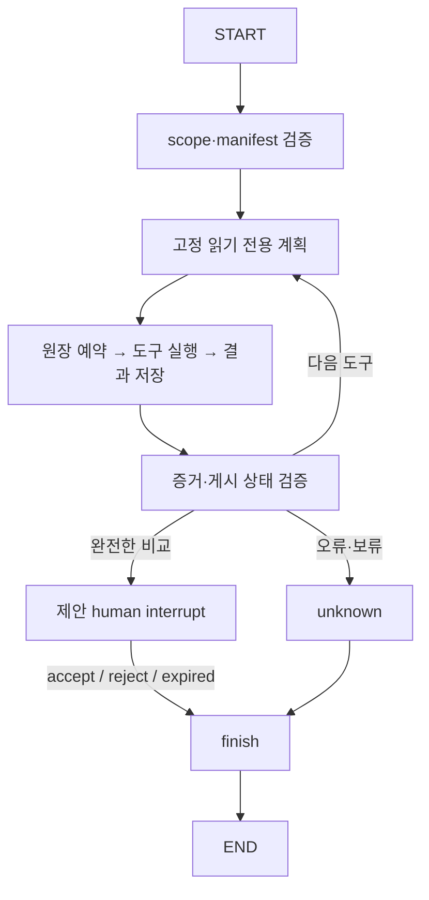

# AC5: 로컬 그래프 재개·복구

권위 입력: `AGENTS.md`, `work/marketing-aws-implementation-brief.md` 5번 및 6번,
현재 Seed AC5. 원문은 보존했다. 이 문서는 조력자의 구현과 로컬 검증 범위다.
학습자의 직접 실행이나 프로덕션 운영을 입증하지 않는다. 실제 모델 비교는 별도 AC다.
이 그래프는 **결정론적 진단 그래프**이며 LLM 실행으로 표시하지 않는다.

## 구조와 선택 이유

LangGraph 1.0.10 / langgraph-checkpoint-sqlite 3.0.3을 직접 고정하고 전이 의존성은
`uv.lock`에 고정한다. 공식 [interrupt 설명](https://docs.langchain.com/oss/python/langgraph/interrupts)의
`interrupt`, `Command(resume=...)`, `thread_id` 및 노드 재실행 의미를 사용한다.
새 버전 전용 `response_schema`는 사용하지 않고 호스트가 accept/reject를 검증한다.



고정 순서는 metrics → quality → freshness → finish이다. SQL/숫자/증거 검증은
기존 `DiagnosticSession`을 재사용한다. 그래프의 v1 adapter는 세션의 카운터,
seen tool 집합, 증거 원문, terminal 상태를 저장·복원한다. 경계 코드 변경 시 이
adapter와 재개 테스트를 함께 검토해야 한다. 새로운 모델 도구나 임의 실행기는 없다.

단일 SQLite 파일에 LangGraph checkpoint와 별도의 실행 원장·제안 검토 기록을 둔다.
`flock`은 DB 전체를 한 실행자가 사용하도록 제한하며 충돌은 대기하지 않고
`resume_busy`로 거절한다. thread별 병렬 처리량보다 로컬 복구의 단순성을 택했다.
파일 잠금은 같은 Mac 로컬 파일시스템의 협조적인 호출자 경계다. 네트워크 파일시스템,
멀티호스트, 불신 로컬 사용자의 DB 조작, 공개 인증 서비스는 지원하지 않는다.

## 저장 경계와 실패 정책

- binding: 그래프 버전, 절대 제품 경로, scope, manifest/payload 해시, limits,
  최초 wall-clock 시작 시간을 저장한다. 재개 시 동일성 확인 후 checkpoint를 읽는다.
- 실행 전 `pending` 원장을 FULL 동기화 SQLite transaction으로 저장한다.
  도구 반환 후 결과·전체 session을 저장한 다음 그래프 checkpoint가 진행한다.
- pending에서 죽으면 도구가 실행되었는지 확신할 수 없다. 재실행하지 않고
  `interrupted_action`, unknown으로 종료한다. 남은 action/tool/token 예산은
  보수적으로 모두 소진 처리한다. 새 thread는 사용자가 명시적으로 시작해야 한다.
- 결과 저장 직후 죽으면 원장 결과를 재사용한다. 도구와 예산 debit을 반복하지 않는다.
- review 기록 저장 직후 죽으면 thread별 동일 proposal/decision 기록을 재사용한다.
  다른 decision 재개는 `decision_conflict`다. 외부 incident 게시나 예산 변경은 없다.
  로컬 검토 기록 한 건 보존을 외부 side effect의 exactly-once 보장으로 해석하지 않는다.
- 시작부터 30초 실행 예산은 프로세스 재시작으로 초기화되지 않는다. 실행 중 crash와
  다운타임도 경과 시간에 포함한다. 사람 검토 대기는 도구 실행이 끝난 뒤이므로
  별도 승인 대기이며 새 도구 예산을 만들지 않는다. 시계가 뒤로 이동해도 음수
  경과 시간을 부여하지 않는다. 운영에는 신뢰된 시스템 시계가 필요하다.
- 재개와 노드 경계에서 CURRENT/manifest/artifact 해시를 검사한다. 게시 교체는
  `stale_snapshot`, 내용 변조는 `snapshot_integrity`다. 과거 결과를 새 게시에 섞지 않는다.
  각 검사 시점 기준이며 게시자와 독자가 전역 transaction을 공유하지는 않는다.
- 승인 시 현재 시계로 freshness/완전성 gate를 다시 확인한다. 오래된 근거는
  `expired`, unknown으로 닫고 검토 기록을 만들지 않는다. 승인으로 데이터가 신선해지지 않는다.
  완료된 thread 재조회는 원래의 역사적 결과이며 현재 상태를 재진단한 결과가 아니다.

한도 수치는 AC3의 보수적인 엔지니어링 기본값을 상속한다. 브리프가 지정한 수치라고
주장하지 않는다. 승인 입력에는 자유문장, 새 scope, 예산 지시를 허용하지 않는다.
`accept`도 조사 제안을 기록할 뿐 실행 권한을 추가하지 않는다.

## 실행·복구

기존 제품 build 후 `CURRENT.json`의 snapshot_id를 사용한다. 이 CLI는 기존 CLI/API와
분리된 추가 진입점이다. DB는 Git 제외 `runs/` 아래에 둔다. 아래 합성 시계 옵션은
과거 fixture 재현용이며 실시간 freshness 증거가 아니다. 실사용은 옵션을 생략한다.

```sh
uv run --locked python -m llm_ops_lab.marketing.graph_cli start \
  --root "$PRODUCT_DIR" --database runs/marketing/checkpoints.sqlite \
  --thread investigation-1 --snapshot "$SNAPSHOT_ID" --account alpha \
  --start 2026-09-20 --end 2026-09-21 --evaluation-now 2026-09-23T12:00:00Z

# 첫 프로세스가 끝난 뒤 새 프로세스에서 같은 scope로 재개
uv run --locked python -m llm_ops_lab.marketing.graph_cli resume \
  --root "$PRODUCT_DIR" --database runs/marketing/checkpoints.sqlite \
  --thread investigation-1 --snapshot "$SNAPSHOT_ID" --account alpha \
  --start 2026-09-20 --end 2026-09-21 --evaluation-now 2026-09-23T12:00:00Z \
  --decision accept
```

거절은 `--decision reject`. 실행 중 crash 복구는 decision 없이 resume한다.
동시 실행은 기존 프로세스 종료 후 다시 시도한다. stale이면 새 게시의 scope로 새 thread를
시작한다. 충돌한 기존 thread/DB를 삭제하거나 덮어써서 예산을 초기화하지 않는다.
성공 stdout은 JSON, stderr는 비어 있다. 실패는 JSON 오류, stderr 사유, 종료 코드 1이다.
인자 파싱 실패는 argparse 코드 2이다. 수용 테스트의 `os._exit(73)`는 명시적인
강제 종료 장치이며 모델 동작을 흉내 내거나 모델 증거를 만들지 않는다.

## 수용 증거 연결

각 항목은 2,000자 미만이며 브리프 원문 전체를 복제하지 않는다.

| 출처 | 구현·검증 |
|---|---|
| 브리프 5: file-backed SQLite/new-process | `graph.py`, `graph_cli.py`; subprocess start/resume, accept/reject 후 scope/evidence/usage 동일성 |
| 브리프 5: scope/thread/input isolation | binding 대조; alpha/beta 증거 분리, 변경 계정/날짜/limits, 없는 thread/중복 start 거절 |
| 브리프 5: concurrent/stale/source-change | DB flock, CURRENT/manifest/artifact 대조; 실제 별도 프로세스 충돌 및 변조 거절 |
| 브리프 5,6: crash/replay | 예약 직후, 도구 반환 직후, 원장 완료 직후, 검토 저장 직후 os._exit; terminal unknown 또는 완료 결과 재사용, 검토 단일 기록 |
| 브리프 5: 증거/예산 보존 | 동결 acceptance/독립 expected 금액 비교, 증거 ID·원문·사용량 동일성, timeout, 오래된 승인 보류 |

수용 명령은 `scripts/verify_marketing_ac2.py` observer를 통해 임시 외부 복사본에서
실행한다. 원본 해시를 전후 대조한다. localhost:8000과 추론 워커는 사용하지 않는다.

```sh
python3 scripts/verify_marketing_ac2.py -- uv run --locked pytest -q tests/test_marketing_graph.py
python3 scripts/verify_marketing_ac2.py -- uv run --locked pytest
python3 scripts/verify_marketing_ac2.py -- uv run --locked pytest -q
python3 scripts/verify_marketing_ac2.py -- uv run --locked ruff check .
```

## 검토 후 갱신

현재 보존 증거는 18개 복구 사례다. 완료 검토가 원장에 저장된 뒤 중단되고 오랜 시간이
지난 경우에는 이미 확정된 역사적 결정을 먼저 재생한다. 아직 확정되지 않은 새 승인에는
현재 freshness gate를 적용한다. 지연 replay 테스트가 이 차이를 검증한다.
[현재 증거](../../evidence/marketing-ac5-recovery.json)와
[수정 전 증거](../../evidence/marketing-ac5-recovery-before-review-repairs.json)를 분리했다.
