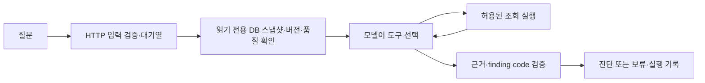

# Olist 조사 에이전트와 API

이 경로는 게시된 실제 Olist 표본을 읽는다. 모델이 도구를 선택하고, 호스트가 고정 SQL과
근거 검증을 수행한다. 최종 문장은 검증된 finding code를 바탕으로 프로그램이 만든다.
따라서 자유로운 분석문 작성이나 원인 규명 전체를 모델이 수행했다고 주장하지 않는다.

## 실행 흐름



도구는 `channel_funnel`, `seller_funnel`, `run_history`, `definitions` 네 가지다.
모델은 SQL·연결 문자열·다른 버전을 지정하거나 데이터를 변경할 수 없다.
스냅샷을 여는 시점의 현재 게시 버전과 요청 버전을 구분하며, 조사 도중 게시가 바뀌어도
한 조사 안의 근거는 같은 REPEATABLE READ 스냅샷에서 읽는다.

모델 호출·토큰·도구 수·SQL 시간·전체 요청 시간을 제한한다. 잘못된 JSON은 제한적으로
재요청하고, 없는 근거나 지원하지 않는 결론은 실패 시 답변을 보류한다.
반환된 `trace`는 동작과 출력 해시를 기록하며 API에는 모델의 자유로운 원문을 노출하지 않는다.
`pipeline_context`는 [의존 그래프](olist-lineage.md)로, 실패 단계와 후보 영향을 설명한다.
현재 포인터 하나만으로 과거 장애 전후의 정상 버전 보존을 입증하지 않는다.

기존 `/v1/answers`와 새 `/v1/investigations`는 **동일한 모델 프로세스와 대기열**을 쓴다.
두 요청 종류를 동시에 보내도 모델을 하나 더 적재하지 않는다. 전체 요청 deadline은 대기시간을
포함하며, 초과 시 기존 supervisor가 작업 프로세스를 종료·회수한 뒤 재기동한다.
현재 구조의 병목은 한 번에 한 요청만 생성하는 모델이다. 우선 큐를 제한하고 429로 부하를
되돌리며, 다중 GPU나 무한 큐로 확장했다고 주장하지 않는다.

## 원격 Super 연결

[Nemotron Super HTTP 실행·실패 계약](olist-nvidia-http.md)을 참고한다.
`--olist-provider nvidia-super --olist-engine intent-v1`로 명시적으로 선택한다.
이 모드에서는 MLX를 적재하지 않고 `/v1/investigations`만 모델을 사용한다.
아래의 공유 로컬 모델 설명과 실행 명령은 기본 `local` 모드에 해당한다.

## 로컬 실행

프로젝트 루트에서 실행한다. Docker PostgreSQL과 로컬 모델 캐시가 필요하다.
실제 모델 평가와 API 서버를 동시에 시작하지 않는다. macOS 메모리 압력이 정상인지 먼저 확인한다.

```bash
cd /path/to/agentic-marketing-data-pipeline
sysctl kern.memorystatus_vm_pressure_level

# 서버를 실행하지 않은 상태에서 실제 모델 평가
uv run --locked --extra local python -m llm_ops_lab.olist.evaluation

# 평가 종료 후 서버 실행; 기존 8000 서버와 겹치지 않도록 별도 포트
uv run --locked --extra local llm-lab-serve \
  --olist-root "$PWD" --port 8011 --request-timeout 60
```

새 터미널에서:

```bash
curl -sS http://127.0.0.1:8011/v1/investigations \
  -H 'Content-Type: application/json' \
  -d '{"question":"커머스 데이터에 연결되지 않은 판매자의 주문을 0건으로 봐도 되나요?"}'
```

`--olist-root`가 없으면 새 경로는 503으로 비활성 상태를 알린다.
기본적으로 reader 자격증명을 프로젝트 `work/olist/secrets`에서 읽는다.
요청은 `question`과 선택적인 64자리 `version_id`만 받는다. 연결 문자열·SQL·여분 필드는 422다.
응답의 request ID로 `runs/service/access.jsonl`과 개별 실행 JSON을 연결할 수 있다.

## 평가의 의미

[6개 개발용 사례](../data/olist/investigation-eval-v1.json)는 판매자 연결, origin 누락,
파이프라인 이력, ROAS/CAC, 30일 귀속, 지시 무시 공격을 다룬다.
평가기는 고정 진단을 근거 기준선으로 저장하고, 실제 모델의 도구 선택과 근거 인용·기대 코드·
보류를 검사한다. 무관한 오류로 보류한 것을 올바른 지표 제한 답변으로 채점하지 않는다.
이 기준선은 질문별 에이전트가 아니므로 동일한 에이전트 정확도 비교로 포장하지 않는다.

실행 결과는 `runs/olist-investigations/<UUID>/`에 별도로 보존한다.
단위/DB/API 테스트의 scripted model은 안전장치 검사이며 실제 Qwen의 품질 증거가 아니다.
6개 smoke 사례의 통과도 미공개 질문에 대한 일반화나 운영 품질을 보장하지 않는다.

## 다음 승격 조건

1. 실제 Qwen 모델 평가·수동 검토 후 읽기 전용 로컬 실험 기능으로 검증한다.
2. 실제 HTTP 요청에서 모델 재사용, 요청 로그, 과부하와 timeout 회복을 다시 검증한다.
3. 새 Olist 모델 루프의 체크포인트·재개를 구현할 때는 불완전한 도구 실행의 재시도 정책과
   버전/프롬프트/정책/예산 복원을 함께 검증한다. 기존 합성 데이터용 그래프 검증을 이 경로의
   복구 증거로 재사용하지 않는다. 현재 Olist 모델 루프는 요청 실패 시 새 조사로 시작한다.
4. [AWS 이전 조건](olist-aws-readiness.md)을 확정한 후 배포를 진행한다.
